# How the IFC Import Reads Geometry

How the importer turns an IFC model's geometry into PGSuper input: what it measures, where, and which PGSuper data each measurement sets. It applies to any model. Nothing here depends on an agency's names, shapes, or libraries; where a model's names or properties play a part, they come through the mapping table (see [MappingTablesDesign.md](MappingTablesDesign.md)).

The figures are schematic (not to scale). They're made by [`images/import-geometry/make_figures.py`](images/import-geometry/make_figures.py): edit it and run it to change them.

## 1. Conventions

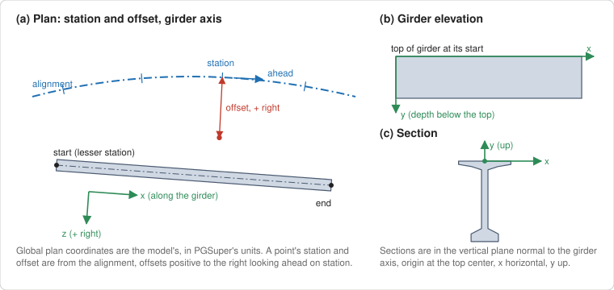

- **Global coordinates** are the model's world coordinates (IfcOpenShell's `use-world-coords`), converted to PGSuper's system units (SI: m, kg, Pa). Every element's placement is applied, so elements placed relative to each other or along the alignment are all in one frame.
- **Station and offset** are from PGSuper's alignment (`IRoadway::GetStationAndOffset`), once the alignment is imported. Offsets are positive to the right looking ahead on station.
- **Girder coordinates** (strands and bars): x is the distance from the start of the girder in plan, z the offset from the CL girder (positive to the right), and y the depth below the top of the girder. The start is the girder end at the lesser station.
- **Section coordinates** (girder sections): a vertical plane normal to the girder axis, origin at the top center of the section, x horizontal, y up.
- **Traffic barrier coordinates**: PGSuper's, from the edge of the deck at the top of the deck, x positive toward the roadway.
- **Which elements**: the mapping table's element roles (`girder`, `deck`, `haunch`, `bearing`, `diaphragm`, `barrier`, `tendon`, `rebar`, ...) select the elements; girders must also be in the superstructure's spatial structure. Piers and abutments are the `IfcBridgePart`s with predefined type PIER and ABUTMENT.

## 2. Common techniques

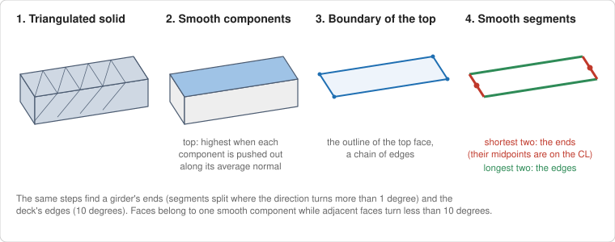

**Meshes.** Each element's body is triangulated by IfcOpenShell (OpenCASCADE kernel, vertices welded, openings not subtracted). The import works on the triangles (`Geometry.h`, `Mesh`):
- **Smooth components:** faces are grouped while adjacent faces turn less than 10 degrees, so a girder's top, sides, and ends are separate components.
- **The top:** the component that's highest when each component is pushed out along its average normal (`get_top_mesh`). This picks the upward-facing surface even when the solid's sides are taller than its top is wide.
- **Boundary and segments:** the outline of the top component is a chain of edges, split into smooth segments where the direction turns more than a limit (1 degree for girders, 10 for the deck). The shortest segments are the ends; the longest are the edges.

**Cuts.** A vertical plane cuts a mesh into closed loops (`CutMesh`, the largest first), or into loose segments when the mesh is several touching solids, e.g. a deck slab with separate haunches (`CutMeshSegments`). Sections are cut normal to the alignment (deck, roadway, barriers) or normal to the girder axis (girder sections).

**Probes.** `Mesh::z_range_at(x, y)` gives the lowest and highest elevation of a mesh at a plan point, or nothing outside its footprint. Deck thickness, slab offset, and girder top elevations are probes; edges along a cut line are found by stepping outward and bisecting to 1/64 in.

**Robust summaries.** Measurements are taken at several places and combined by the median (lengths) or the most common value (choices such as an overhang taper), so a local detail or a glitch in the geometry doesn't decide a value. Where values are expected to agree, the spread is checked and logged.

**Logging.** Every value set from geometry is logged with how it was found, and every value that couldn't be measured is logged with what's used instead (usually the template's).

## 3. Order of the steps

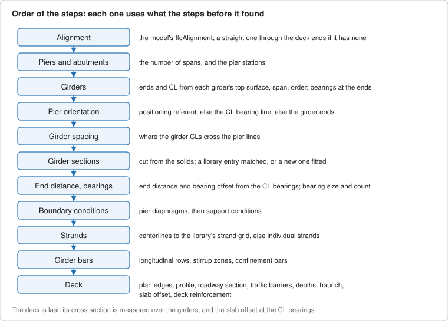

Each step uses the results of the steps before it (`CIfcBridgeImporter::Import`). The import starts from `IfcImportTemplate.pgt`; anything not found keeps the template's value, and the log says so.

## 4. Alignment and profile

- **Alignment:** from the model's `IfcAlignment` (horizontal, vertical, and cant), not from geometry.
- **No alignment:** when the model has none and the user asks for it, a straight alignment is made through the centers of the deck's two ends (the two shortest segments of the deck's top outline). It's a best effort, so the deck can be stationed (`create_alignment_from_deck`).
- **Profile from the deck** (`import_profile`): the top of the deck at the alignment is sampled about every 10 ft (at least 8 times in each span), out to the end piers as far as the deck goes. A sample more than 1/2 in from the local profile (a parabola through 3 of its 8 nearest neighbors that most of them agree with) is left out as a glitch. The simplest profile within 1/8 in of the samples is fitted: one tangent, else one vertical curve, else tangents and symmetric parabolic vertical curves, adding knots where the fit improves most and removing them where it stays within tolerance.
  - If the alignment has no vertical alignment, the fit becomes PGSuper's profile.
  - If it has one, the fit is only compared with it, and a difference is logged (the profile grade is the roadway surface).

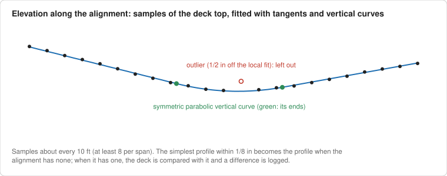

## 5. Piers and abutments

- **Number of spans:** the number of abutments and piers, less one. A number-of-spans property (`bridge.number_of_spans`) is only a cross check: a conflict is logged and the modeled substructure wins.
- **Pier stations:** the station of the `IfcReferent` that positions the pier (`Pset_Stationing.Station`). Without one, the station of the center of the bounding box of the bearings in the pier's spatial structure. With neither, 100 ft apart (logged). The piers are sorted by station.

## 6. Girder layout

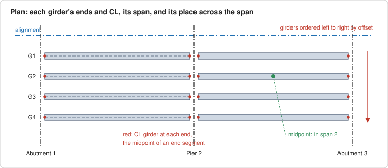

For each girder solid (`get_girder_layout`):
1. The top surface is found and its outline split into segments (Section 2).
2. The **two shortest segments are the girder's ends**; the midpoints of their bounding boxes are on the CL girder, at the top of the girder. They give the girder's CL in plan, its top elevation at each end, and the station and offset of each end. The start is the end at the lesser station.
3. The girder is in the **span that contains its midpoint**.
4. Within a span, girders are **ordered left to right by offset**. A girder designation in the model (`girder.designation`, else the name) is a cross check; a conflict is logged and the location wins.

This sets the **number of girders** (the same in every span, or per span; a span needs at least two) and each girder's span and girder index. Because the ends come from the top surface, skewed and square ends work the same way.

## 7. Pier orientation

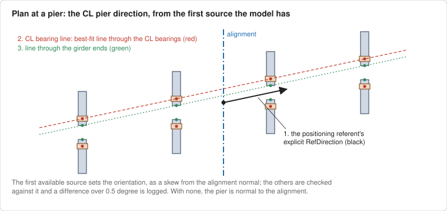

The CL pier direction comes from the first source the model has (`set_pier_orientation`):
1. an explicit `RefDirection` in the linear placement of the referent that positions the pier;
2. the **CL bearing line**: the best-fit line (principal direction) through the CL bearings of the girders on a pier face (Section 10), when every girder there has bearings;
3. the **line through the girder ends** on a pier face.

The direction is written as a PGSuper orientation (a skew from the normal to the alignment). The other sources are checked against it, and a difference of more than 0.5 degree is logged. A pier with none of them is normal to the alignment.

## 8. Girder spacing

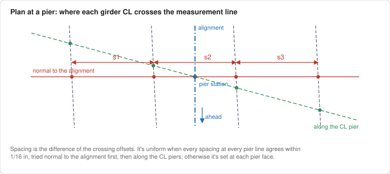

Spacing is measured at each pier line where the girder CLs cross a line through the alignment at the pier station (`get_beam_spacing`), both normal to the alignment and along the CL pier. The spacing between adjacent girders is the difference of their crossing offsets, at the start (ahead face) and end (back face) of each span.

- **Uniform:** if every span has girders and all of the spacings at every pier line agree within 1/16 in, one spacing is set for the bridge, measured at the pier lines. Normal to the alignment is tried first (so a bridge without skew keeps its datum), then along the CL piers.
- **General:** otherwise each pier face gets its own spacings, measured normal to the alignment at the pier line.

## 9. Girder section and library entry

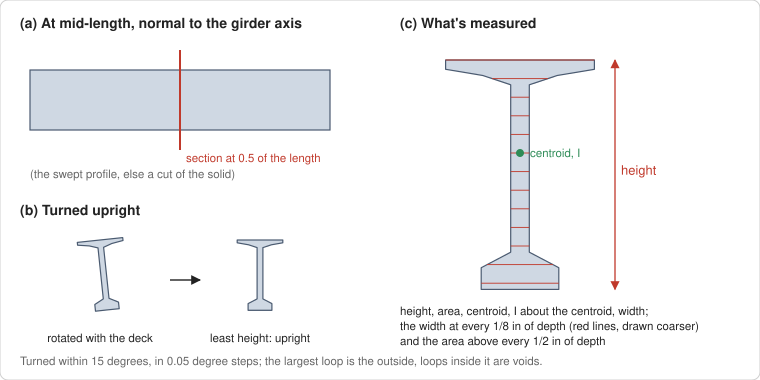

**The section** (`CutGirderSection`, `MeasureSection`):
- The girder solid is cut by a vertical plane normal to its axis at **mid-length**, away from end blocks and tapers.
- A girder can be rotated about its axis (e.g. to the deck's cross slope). The section is **turned upright**: rotated within 15 degrees, in 0.05 degree steps, to where it's least high (girders have flat tops and bottoms, so this works for sections that aren't symmetric too). Less than a quarter degree is left alone.
- The largest loop is the outside of the section; loops inside it are **voids**.
- **Measures:** height, area, centroid, moment of inertia about the centroid, overall width, the material width at every 1/8 in of depth (the width profile), and the area above every 1/2 in of depth (the area profile, which changes smoothly with the dimensions, for fitting).

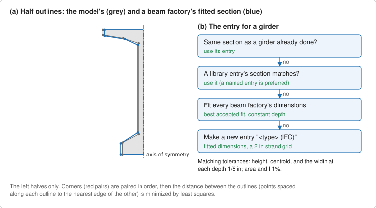

**The library entry** (`GetGirderLibraryEntry`, `MatchLibraryEntry`), in order:
1. **Same section as a girder already done:** outlines within 1/8 in (Hausdorff distance), area and I within 1%, centroid within 1/8 in. That girder's entry is used without fitting again (the girders of a span, often of the bridge, are one shape; sections cut from geometry differ only by the measurement).
2. **A library entry's section matches** (`ExactSectionComparison`): height, centroid, and the width at every depth within 1/8 in, area and I within 1%. An entry named like the model's girder type (`girder.type_names`, compared ignoring case, spaces, and punctuation) is preferred when its section matches. A name never overrides the geometry: a geometric match with another name is used and logged.
3. **Fit a beam factory's dimensions** (`OutlineDimensionFitter`): every installed beam factory is fitted, starting from its closest library entry's dimensions and from its defaults. The height is solved first; then all of the length dimensions are fitted by least squares on the left half outlines (girder sections are symmetric), once pairing the corners in order and then minimizing the outline distance, and once by the outline distance alone (better for curved sections). Dimensions a factory rejects, negative lengths, and outlines that cross themselves are rejected.
   - The fit is accepted by `FittedSectionComparison`: as in step 2, except that widths may differ over 1/2 in of depth in total (local details a family can't make, such as a flange tip's corner), or anywhere the outlines are within 1/8 in of each other (a small offset on a shallow taper is a large width difference).
   - The girder has a constant depth, so a fit must too (`MakeConstantDepth`): a dimension that only shapes the far end of a varying-depth girder is solved so both ends have the same height, or the fit is rejected.
   - Ties between factories that make the same shape: a factory made for constant-depth girders is preferred; then the user picks; a command-line import takes the factory published by WSDOT, else the best fit.
4. **A new library entry**, "<girder type> (IFC)" (" (2)" and so on if the name is taken), from the best factory with the fitted dimensions rounded to 1/16 in (US units) or 1 mm, and a generated strand grid: positions on a 2 in grid at least 2 in from the edges and voids, straight strands in the lower half, harped strands in the web column, temporary strands in the top quarter (`GenerateStrandGrid`).

If the section can't be cut, the entry is found by name only, and the log says so. When girders get different entries, adjacent girders with the same entry are grouped (PGSuper requires a group's girders to share an entry). The girder orientation is the factory's first supported orientation; it isn't measured yet.

## 10. Bearings, end distance, and bearing offset

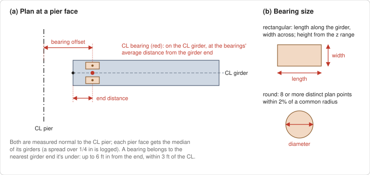

- **Which girder end** (`locate_bearings`): a bearing (by its plan bounding box center) belongs to the nearest girder end it's under: from 1/2 in outside the end to 6 ft in from it, and within 3 ft of the CL girder.
- **CL bearing:** on the CL girder, at the average distance of the end's bearings from the end of the girder.
- **End distance and bearing offset** (`set_end_distance_and_bearing_offset`), measured normal to the CL pier (Section 7) for each pier face, as the median of the face's girders (a spread over 1/4 in is logged):
  - end distance: from the end of the girder to the CL bearing;
  - bearing offset: from the CL pier (through the alignment at the pier station) to the CL bearing.
  - A face whose girders have no bearings keeps the template's end distance; the bearing offset is then what puts the girder ends where they are in the model.
- **Bearing data** (`set_bearing_data`): from the first bearing at a girder end, in its plan outline relative to the girder axis: **round** if it has 8 or more distinct plan points all within 2% of a common radius (diameter), else **rectangular** (length along the girder, width across). The **height** is its elevation range. The **number of bearings** at the end, and their **spacing** across the girder (first to last over the count less one). Fixity comes from properties (`bearing.fixed_x`, `bearing.fixed_y`). The bearing data is set for the whole bridge, for each pier face, or for each girder, the simplest that fits (sizes within 1/16 in).

## 11. Boundary conditions

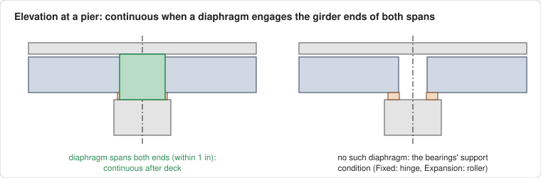

For each pier (`set_boundary_conditions`), with the evidence logged:
1. **Continuous after the deck** if a pier diaphragm (the `diaphragm` role) across the girder ends, within 6 ft of the CL pier, engages the girder ends of both spans, all of them within 1 in of its extents normal to the CL pier, as PGSuper requires of a continuity diaphragm.
2. Otherwise the **support condition of the bearings** (`bearing.support_condition`: Fixed/Hinge/Pinned is a hinge; Expansion/Roller/Free/Sliding a roller; bearings alone are never continuous),
3. else of the **diaphragms** (`diaphragm.support_condition`; an abutment can't be continuous),
4. else a hinge at the first abutment and rollers elsewhere (assumed, and logged).

## 12. Strands

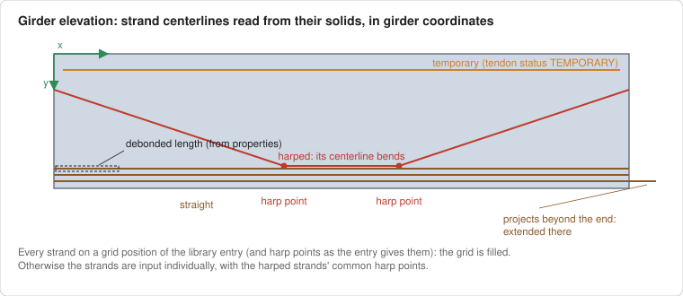

The strands are the elements of the `tendon` role (`Strands.h`, `GirderReinforcement.h`):
- **Girder:** the one the strand is part of through its assemblies, else the one whose solid contains the strand's midpoint, else the one that contains most of it.
- **Centerline:** read from the body geometry, following mapped items: circular profiles extruded along a line and swept disks along polylines or indexed curves are the straight pieces, chained end to end through the bends between them (e.g. revolved solids). An element with several representation items that make lines is a group of strands, one per item.
- The centerline is **clipped to the girder's plan footprint** and put in girder coordinates, its depth measured from the girder's top sampled along its length (so strands parallel to a curved girder are straight). Tendons that don't run the girder's length (e.g. lifting loops) are skipped.
- **Kind:** temporary if `tendon.status` is TEMPORARY, harped if the centerline bends, else straight. The harped strands share PGSuper's harp points: their common bend points.
- **Extended strands:** a straight strand that projects more than 1 in beyond an end of the girder is extended at that end, unless it's debonded there. PGSuper keeps only that it's extended, not the shape of the extension; projecting harped and temporary strands are logged and only their part in the girder is imported.
- **Strand input:** if every strand is at a position of the library entry's strand grid (harped strands with a common vertical offset at each end and harp point, found by trying each position for the lowest strand), and the entry's harp points are the model's within 1/8 in, the **grid is filled** (`sdtDirectSelection`) with the harped strand offsets. Otherwise the strands are input **individually** (`sdtDirectStrandInput`) with the common harp points. An entry the import created first gets the harp point location that gives the model's harp points for all its girders, if one does.
- **From properties:** debonding (`tendon.debond_start`, `tendon.debond_end`), the strand material (`tendon.diameter`, else the type's nominal diameter, else the drawn diameter; `tendon.fpu`, `tendon.grade`, `tendon.corrosion_treatment`), and the jacking force (`IfcTendon.PreStress`, else `TensionForce`, else `tendon.tension_force`). A girder without strands keeps the template's.

## 13. Girder reinforcement

The bars are the elements of the `rebar` role in the girders, read once with the same centerline reader as the strands (`GirderBars.h`). Each girder gets exactly the model's bars, none if it has none: a library entry's bars are seed values, not the girder's reinforcement. The bar size is `rebar.bar_size`, else the bar type's nominal diameter, else the drawn diameter (within 0.1 in); the material is from `rebar.grade` and `rebar.fy`, the most common in the girder.

**Longitudinal bars** (`LongitudinalRebar.h`):

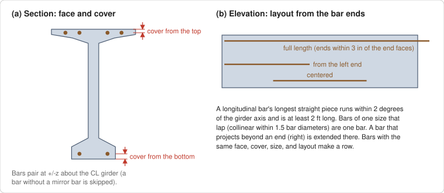

- A bar whose longest straight piece in the girder runs within 2 degrees of the girder axis and is at least 2 ft long. Bars of one size that lap (collinear within 1.5 bar diameters, overlapping) are one bar.
- **Face and cover:** the nearer of the top and bottom faces (from the girder's depth in the model), and the clear cover to it.
- **Layout:** full length when both ends are within 3 in of the end faces (measured along the bar, so skewed ends work), from the left or right end when one is, centered when it's centered, else from the nearer end. A bar that projects beyond an end is extended there, when it's full length or starts at that end.
- **Rows:** bars with the same face, cover, size, and layout. PGSuper centers a row's bars on the CL girder at one spacing, so unequally spaced bars are split into pairs at plus and minus z (and a bar at the center). A bar without a mirror bar can't be input; it's skipped with a warning.

**Stirrups** (`Stirrups.h`):

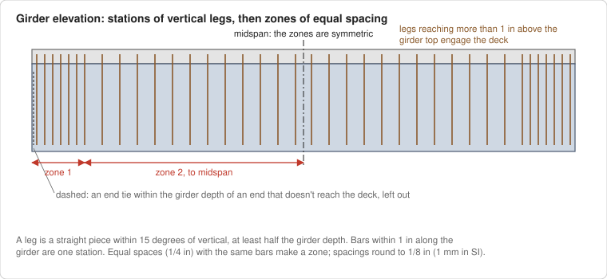

- A **stirrup** has a vertical leg: a straight piece within 15 degrees of vertical, at least half the girder's depth long.
- **Stations:** bars within 1 in of each other along the girder are one station, with the sum of their legs. A leg whose top is more than 1 in above the girder's top engages the deck (horizontal interface shear).
- **End ties** aren't stirrups: within the girder's depth of an end, stations whose legs don't reach the deck, where the next station farther from the end does. They're logged and left out.
- **Zones:** the space before each station is a spacing; consecutive equal spaces (within 1/4 in) with the same bar size, legs, deck engagement, and confinement bar make a zone. When every station has a mirror at the other end (within 1 in) with the same bars, the zones are **symmetric**: made from the first half, the last zone running to midspan. Spacings are rounded to 1/8 in (1 mm with SI display units), and a zone's length is its number of spaces times the spacing.
- **Splitting** reinforcement is the primary stirrups within h/n of the ends (PGSuper's `bUsePrimaryForSplitting`).

**Confinement bars:**

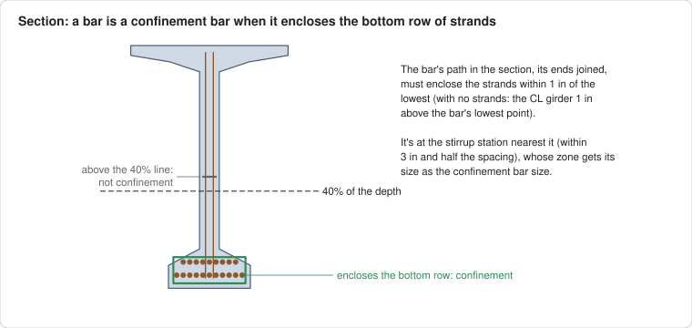

- A **confinement bar** is a girder bar that isn't a stirrup, lies below 40% of the girder's depth, and whose path in the girder's section, its ends joined, **encloses the bottom row of strands** (the strands within 1 in of the lowest; without strands, the CL girder 1 in above the bar's lowest point). It's recognized by geometry only, never by bar marks or shape codes, so closed ties and bars around the bottom flange both qualify.
- It's at the stirrup station nearest to it, within 3 in and half the spacing there, and that station's **confinement bar size** is its size (the bar that encloses the most, if several). PGSuper's confinement bars are at the stirrups, at the zone's spacing, so a zone ends where the confinement starts or stops. A bar at no station is logged and skipped.

## 14. Deck plan

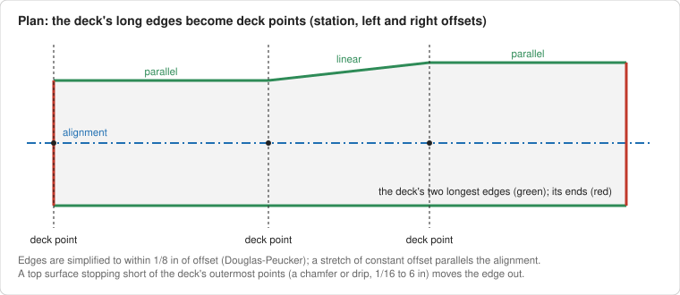

The deck slab is the first element of the `deck` role (`get_deck_edge_points`):
1. Its top surface's outline is split into segments (10 degrees); the **two longest are the deck edges**. The left edge is the one with the smaller offsets.
2. **Chamfers and drips:** the top surface can stop short of the deck's outermost points. The deck is cut normal to the alignment at its 1/4, 1/2, and 3/4 points, and if the three cuts agree (within 1/8 in) that the outermost point is 1/16 to 6 in outside the top's edge, the edge is moved out by that much.
3. **Deck points:** each edge, as offsets along the alignment, is simplified to within 1/8 in of offset (Douglas-Peucker). The stations where either edge changes direction are the deck points, with the left and right offsets there. A stretch of constant offset parallels the alignment; one that changes is a linear transition. Points in the middle of runs that parallel the alignment on both sides are removed.

The deck type is cast-in-place (stay-in-place panels aren't imported yet).

## 15. Roadway section

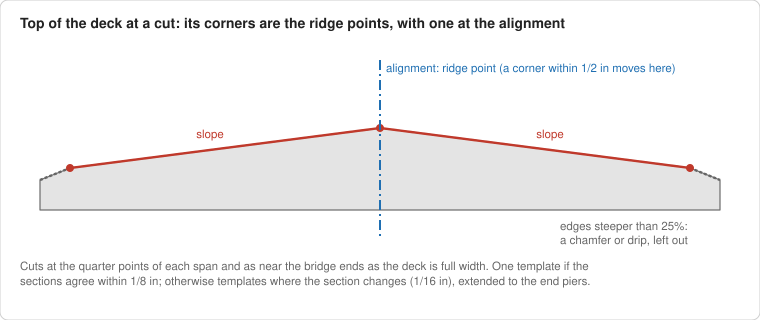

`import_roadway_section`:
- **Cuts:** the deck is cut normal to the alignment at the quarter points of each span, and as near the ends of the bridge as the deck is full width (at least 90% of the median width at the quarter points), to catch superelevation transitions.
- **Ridge points:** the top of the deck, edge to edge (under the barriers too, as PGSuper's roadway surface goes), is reduced to its corners: the ridge points, with one at the alignment (a corner within 1/2 in of it moves there). A segment at an edge steeper than 25% is a chamfer or drip, not roadway.
- **Templates:** the most common number of ridge points is used, and a section missing one of them gets it from the nearest section that has it. If every section agrees within 1/8 in, there's **one template**. In a transition, the first and last sections are extended linearly to the end piers. Otherwise there's a template wherever the section isn't what PGSuper's interpolation between its neighbors gives (within 1/16 in).
- Slopes are measured away from the alignment point, as PGSuper defines them.

## 16. Traffic barriers

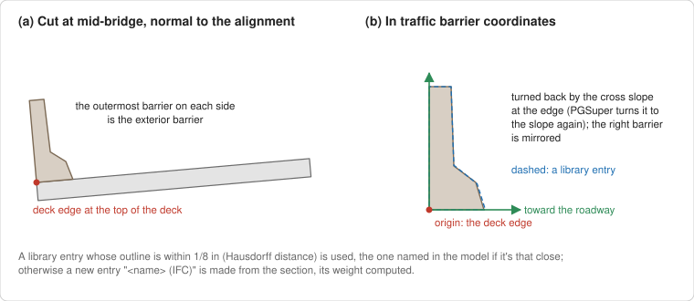

`import_traffic_barriers`:
- **Cut:** the `barrier` elements and the deck are cut normal to the alignment at the middle of the bridge (barrier end sections and transitions are at the ends). A barrier is on the side of the alignment its section's center is on; the **outermost on each side is the exterior barrier** (others are logged: sidewalks and interior barriers aren't imported yet).
- **Barrier coordinates:** the section is moved to the edge of the deck at the top of the deck (the outermost point of the deck section), oriented positive toward the roadway (the right barrier is a mirror of its library entry), and **turned back by the roadway's cross slope** at the edge. PGSuper turns barriers to that slope, so the roadway section must be imported first. The slope of the deck under the barrier is a check, logged if it differs from PGSuper's. The outline is simplified to its corners (1/64 in).
- **Library entry:** the entry whose outline is within 1/8 in (Hausdorff distance) is used, the one named by `barrier.type` if it's within the tolerance too. Otherwise a **new entry** "<name> (IFC)" is made from the section's points, its weight computed from the area. A side with no barrier at mid-bridge keeps its railing system.

## 17. Deck cross section

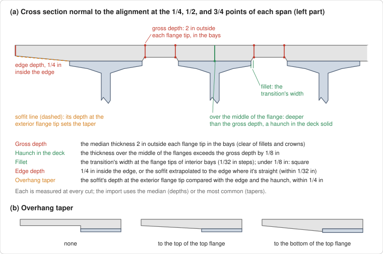

`analyze_deck_section` measures the deck concrete: the deck slab and any separate haunches (parts aggregated under the deck, and elements of the `haunch` role), as one mesh. It's cut normal to the alignment at the 1/4, 1/2, and 3/4 points of each span. At each cut, the top flange extents of every girder (by probing outward from the CL girder) and the deck edges are found; a cut that doesn't find every girder is skipped.

| PGSuper input | How it's measured at each cut | Combined |
|---|---|---|
| Gross depth | Deck thickness 2 in outside each flange tip, in every bay (clear of fillets and of crowns at mid-bay) | Median |
| Haunch shape | A haunch is part of the deck solid where the thickness over the middle of the flanges exceeds the gross depth by 1/8 in | Any cut |
| Fillet | At the flange tips of interior bays: the width of the transition from the slab soffit to the bottom of the haunch, walking from 2 in in the bay over the flange in 1/32 in steps | Median; under 1/8 in is a square haunch |
| Overhang edge depth | 1/4 in inside the edge. Where the soffit within 3 in of the edge is straight (within 1/32 in), the soffit line extrapolated to the edge (a tapered soffit isn't parallel to the top); otherwise (a chamfer or drip) the depth just inside the edge | Median |
| Overhang taper | The soffit line (from 1 in inside the edge to 3 in outside the flange tip) at the flange tip, compared within 1/4 in: the edge depth means **none**; the depth to the bottom of the haunch (the top of the girder) means **to the top of the top flange**; deeper means **to the bottom of the top flange**; otherwise the closest. An overhang under 6 in has no taper | Most common |

A deck depth property (`deck.gross_depth`) is a cross check: the geometry wins, and a difference over 1/8 in is logged. The property is used only when the depth can't be measured. Haunches that are separate elements aren't part of the deck solid, so the haunch shape and fillet are the template's then.

## 18. Slab offset

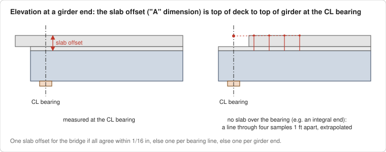

The slab offset ("A" dimension) is the **top of the deck to the top of the girder at the CL girder, at the CL bearing** (from the bearings, else located with the end distance), probed in the deck concrete and girder meshes. Only where there's slab (deck concrete at least the gross depth less 1/4 in), not just a haunch that runs past the end of the slab.

- **No slab over the bearing** (e.g. a deck ending at an integral abutment): from the first point with slab (6 in steps, up to a quarter of the girder), a least-squares line through four samples 1 ft apart is extrapolated to the CL bearing (logged).
- **PGSuper's minimum** is the gross depth plus the fillet. If a measured slab offset is smaller, the fillet is reduced to the thinnest haunch in the model so the measured offsets are kept; only a slab offset less than the deck itself is raised (logged).
- **Input:** one slab offset for the bridge if all agree within 1/16 in, else one per bearing line (pier face) if each line agrees, else one per girder end. The haunch is input as the slab offset (PGSuper's `hidACamber`: "A" and the assumed excess camber).

## 19. Deck reinforcement

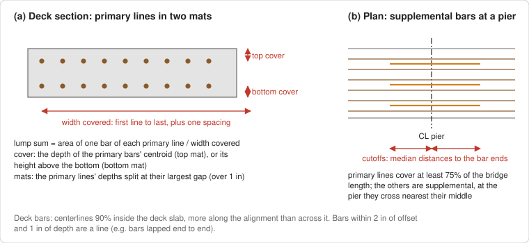

PGSuper's deck reinforcement is a top and a bottom mat, each with primary bars along the bridge and supplemental bars at the piers; only the area per width, the cover, and the supplemental bars' cutoffs matter. The import gives exact lump sums (area per width), whatever the model's bar sizes and spacings (`import_deck_rebar`):
- **Deck bars:** `rebar` elements whose centerlines are 90% inside the deck slab. Bars more along the alignment than across it are used; transverse bars are counted in the log.
- **Lines:** bars at the same offset and depth (within 2 in and 1 in) are a line, e.g. bars lapped end to end. Lines covering at least 75% of the bridge length are **primary**; the others are **supplemental**.
- **Mats:** the primary lines' depths below the top of the deck, split at their largest gap (over 1 in) into the top and bottom mats; with one group, it's the top mat if it's in the upper half of the deck. Every other bar goes to the mat whose primary bars are nearer in depth.
- **Lump sum:** the area of one bar of each primary line (a lap doesn't add) over the width the lines cover (first line to last, plus one spacing). **Cover:** the depth of the primary bars' centroid below the top (top mat), or its height above the bottom (bottom mat). The material is the one most of the mat's bars have.
- **Supplemental bars** belong to the pier they cross nearest their middle; for each pier and mat, the lump sum is computed the same way, and the **cutoffs** are the median distances from the CL pier to the bar ends. Bars that cross no pier are counted and skipped.
- A model without longitudinal deck bars keeps the template's deck reinforcement.

## 20. What doesn't come from geometry

Some PGSuper input is read from properties through the mapping table, because geometry can't show it: concrete strengths (`girder.fc`, `girder.fci`), strand and bar materials, debonding, jacking forces, bearing fixity and support conditions, the girder type name (a hint for the library entry, never an override), and the girder designation (a cross check). The pier stations come from the positioning referents when the model has them. See [Targets.md](Targets.md) for every target and [MappingTablesDesign.md](MappingTablesDesign.md) for how locations are found.

Not imported from geometry yet: stay-in-place deck panels, sidewalks and interior barriers, intermediate diaphragms, superelevation events, the girder orientation (roll), and the girders' drawn camber.

## 21. Tolerances

| What | Tolerance |
|---|---|
| Smooth components of a mesh | adjacent faces within 10 degrees |
| Girder end segments; deck edge segments | 1 degree; 10 degrees |
| Edges along a cut (probing) | 1/64 in |
| Uniform girder spacing | 1/16 in |
| Pier orientation cross check | 0.5 degree |
| Bearing to girder end | 1/2 in outside to 6 ft inside the end, 3 ft from the CL |
| End distance and bearing offset spread (logged) | 1/4 in |
| Bearing data the same | 1/16 in |
| Continuity diaphragm | girder ends within 1 in of the diaphragm; diaphragm within 6 ft of the CL pier |
| Girder section match | height, centroid, widths 1/8 in; area, I 1% |
| Fitted section | as above; widths may differ over 1/2 in of depth, or where outlines are within 1/8 in |
| Same girder section | outlines 1/8 in; area, I 1%; centroid 1/8 in |
| Section turned upright | within 15 degrees, 0.05 degree steps; under 0.25 degree left alone |
| Strand and bar positions | 1/8 in |
| Extended strand | projects more than 1 in |
| Longitudinal bar | within 2 degrees of the axis, at least 2 ft; laps collinear within 1.5 diameters; full length ends within 3 in |
| Stirrup leg; station; engages the deck | 15 degrees, half the depth; 1 in; 1 in above the girder top |
| Stirrup zones | equal spaces 1/4 in; symmetric 1 in; spacings rounded to 1/8 in (1 mm) |
| Confinement bar | below 40% of the depth; strands within 1 in of the lowest; station within 3 in and half the spacing |
| Deck edge outside the top (chamfer, drip) | 1/16 to 6 in, three cuts within 1/8 in |
| Deck points | 1/8 in of offset |
| Deck gross depth property cross check | 1/8 in |
| Haunch in the deck solid; fillet steps; square haunch | 1/8 in; 1/32 in; under 1/8 in |
| Edge depth straight soffit; overhang taper | 1/32 in; 1/4 in |
| Slab offset the same | 1/16 in |
| Roadway: ridge point at the alignment; one template; changes; chamfer | 1/2 in; 1/8 in; 1/16 in; slope over 25% |
| Profile: outlier; fit | 1/2 in; 1/8 in |
| Traffic barrier: library entry; corners | 1/8 in (Hausdorff); 1/64 in |
| Deck bars: in the deck; lines; primary | 90% of length; 2 in offset, 1 in depth; 75% of the bridge length |
